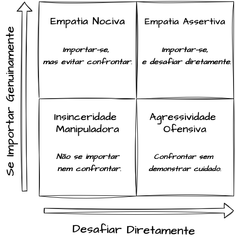
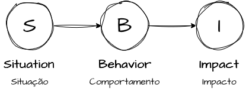
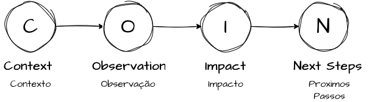
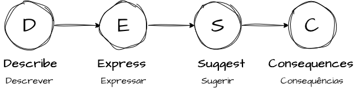

Até pouquíssimos anos atrás, feedback era um tema muito sensível pra mim. Não considero que tenha passado meus primeiros anos de carreira em ambientes muito propensos a esse tipo de dinâmica de forma saudável, então demorei muito pra ter contato com esse tipo de coisa de forma profissional e com método. Por muito tempo, meus feedbacks foram autoinfligidos por reflexões não tão legais comigo mesmo. **E quando migrei pra cadeira de Staff, precisei aprender a dar feedbacks muito antes de saber como recebê-los.** Acho que esse texto carrega muitas experiências tristes, que hoje consigo transformar em algo feliz.

Demorei bastante pra aprender a fazer isso de forma legal e procurei bastante coisa pra me ajudar com isso. Todo o texto foi baseado em três grandes livros que foram minhas principais referências pra descobrir o nome das portas antes de ir atrás de abri-las por meio de outras fontes, sendo eles: **"Comunicação Assertiva", de Kim Scott, "Equipes Brilhantes", de Daniel Coyle, e "Obrigado pelo Feedback", de Douglas Stone e Sheila Heen.** Além dos livros, uma das minhas referências foi uma aula muito legal a que assisti, do Felipe Adamoli.

Passei o último ano estudando e adaptando essas ferramentas pra um padrão confortável de uso diário. **Quando se trata de lidar com pessoas e de como fazer todo mundo ser melhor, sempre há formas de refinar a técnica. Nunca é o suficiente.** Mas espero que essa foto do meu framework atual consiga te ajudar de alguma forma.

 

## Feedback e Senioridade

Conforme avançamos em nossa carreira, a nossa capacidade de execução individual deixa de ser o único fator que determina a qualidade da nossa atuação profissional. Eu disse isso de uma maneira bem bonita. **Mas, na verdade, pouquíssimo importa a nossa execução individual.** Passamos a assumir responsabilidades que envolvem orientar pessoas, influenciar decisões, estabelecer expectativas e desenvolver competências que ultrapassam o nosso próprio domínio técnico. Nesse contexto, a capacidade de dar, receber e solicitar feedbacks precisa ser exercitada, se possível, todos os dias e com muita naturalidade.

Existe uma dificuldade particularmente interessante nesse processo. Conforme acumulamos experiência, construímos convicções a respeito de como determinados problemas devem ser resolvidos, de como as pessoas deveriam trabalhar e de quais comportamentos consideramos adequados dentro de uma organização. Embora esse repertório seja importante para a construção de diversas coisas, ele também pode dificultar a nossa capacidade de reconhecer limitações e considerar perspectivas diferentes das nossas. **E isso é um gigantesco problema.**

No livro "Obrigado pelo Feedback", Douglas Stone e Sheila Heen exploram como o recebimento de feedback envolve uma tensão entre duas necessidades humanas: **o desejo de aprender e evoluir e o desejo de sermos reconhecidos e aceitos da maneira como somos.** Receber uma crítica sobre uma competência que consideramos parte importante da nossa identidade profissional pode ser particularmente desconfortável, principalmente quando essa crítica contraria a percepção que construímos sobre nós mesmos.

Eu mesmo trabalho no meio corporativo, que, para o senso comum, pode ser considerado um ambiente de trabalho "chato", "tedioso", "burocrático" e "executivo demais". Porém, eu mesmo sou pouquíssimo corporativo e considero isso uma qualidade que me abriu muitas portas, mas também fechou várias. Consegui encontrar um equilíbrio nessa régua entre "ser eu mesmo", preservando minha personalidade, e, ao mesmo tempo, não ferir as expectativas do meio em que trabalho, por meio de inúmeros feedbacks valiosos que me orientaram sobre como trabalhar e perceber quando posso ser mais expansivo e quando não...

Para profissionais Staff+, existe ainda uma dificuldade adicional. **A senioridade, a influência e a reputação técnica podem criar barreiras que desestimulam outras pessoas a questionarem nossas decisões.** Um engenheiro que construiu uma reputação de excelência técnica pode, involuntariamente, estabelecer um ambiente em que profissionais menos experientes não se sentem confortáveis para discordar de suas propostas. Isso reduz a quantidade de informações disponíveis para que ele consiga identificar seus próprios pontos cegos. E, novamente, é um gigantesco problema quando o objetivo é muito maior do que a performance individual.

Podemos traçar um paralelo com o conceito de observabilidade na engenharia de software. **O feedback funciona como um mecanismo de observabilidade sobre o nosso comportamento profissional.** Assim como não conseguimos compreender completamente o comportamento de um sistema observando apenas suas características internas, dificilmente conseguimos compreender todo o impacto da nossa atuação utilizando exclusivamente a nossa própria percepção. Precisamos de sinais externos, provenientes de diferentes fontes e contextos, para calibrar nosso comportamento e nossa direção.

**A capacidade de buscar esses sinais com pares, parceiros, líderes e liderados, interpretá-los e utilizá-los como instrumentos de desenvolvimento é uma característica importante de maturidade profissional.** É disso que trata esse texto.

 

## Tipos de Feedback

Embora utilizemos o termo feedback de maneira bastante genérica no ambiente profissional, nem todo feedback possui a mesma finalidade. E tratar todos os feedbacks da mesma maneira é um erro ainda maior pra cadeiras que exercem autoridade formal do que pras nossas. **Reconhecer as estruturas e finalidades de cada tipo de feedback pode ser um grande facilitador.**

Em determinados momentos, precisamos reconhecer a contribuição de uma pessoa. Em outros, precisamos orientá-la sobre como desenvolver determinada competência ou estabelecer uma percepção mais clara sobre seu desempenho perante as expectativas de uma organização. Ainda no livro "Obrigado pelo Feedback", os autores classificam o feedback em três categorias confortáveis: **Reconhecimento (Appreciation), Orientação (Coaching) e Avaliação (Evaluation)**. Cada uma dessas categorias atende a necessidades diferentes, e compreender suas particularidades ajuda tanto quem fornece quanto quem recebe um feedback.

O **reconhecimento** possui como objetivo demonstrar que a contribuição de uma pessoa foi percebida e valorizada. Na engenharia de software, isso pode envolver reconhecer a maneira como um profissional conduziu um incidente, auxiliou outros engenheiros, simplificou uma arquitetura ou assumiu a responsabilidade por um problema complexo. **Um bom reconhecimento não está necessariamente relacionado a grandes entregas.** Muitas contribuições importantes para uma organização acontecem de maneira pouco visível, principalmente quando envolvem colaboração, mentoria e prevenção de problemas, e é nossa missão dar visibilidade pra isso.

A **orientação** possui como objetivo desenvolver uma competência ou melhorar determinado comportamento de uma pessoa em relação à régua do grupo ou às expectativas de determinado contexto. Podemos orientar um engenheiro sobre como estruturar uma proposta de arquitetura, conduzir uma discussão técnica, comunicar riscos ou assumir responsabilidades com maior autonomia. **O foco dessa categoria está na capacidade de ajudar a pessoa a construir novas habilidades e perspectivas sobre algo.**

Já a **avaliação** estabelece uma referência sobre o desempenho de uma pessoa perante determinadas expectativas, acordadas ou implícitas no grupo. Isso pode acontecer durante ciclos de avaliação de desempenho, discussões sobre promoções ou conversas sobre a capacidade de um profissional de assumir determinadas responsabilidades. **Diferentemente da orientação, a avaliação busca comunicar onde a pessoa se encontra em relação a uma régua previamente estabelecida e, principalmente, conhecida.** É um erro pensar que feedbacks se limitam à avaliação ou procurar direcioná-los somente durante períodos desse tipo.

 

## Feedback e Empatia Assertiva

Um dos maiores desafios ao fornecer feedbacks está em encontrar um equilíbrio entre comunicar aquilo que precisa ser comunicado, sem margem para interpretações equivocadas ou ruídos, e preservar a qualidade da relação que temos com a outra pessoa. Existe uma percepção errada de que precisamos escolher entre ser sinceros ou ser empáticos, como se essas duas características fossem necessariamente incompatíveis. Isso pode ser muito difícil, pois exige tanto técnica e adaptabilidade de quem irá direcionar o feedback quanto receptividade da pessoa que irá recebê-lo. **Acho que, quanto menos genérico o método, melhor.** Em contrapartida, isso exige certa proximidade e conhecimento da pessoa para quem a mensagem precisa chegar.

No livro "Empatia Assertiva" (Radical Candor), Kim Scott (2017) propõe um modelo que busca o equilíbrio entre **importar-se genuinamente com as pessoas** (Care Personally) e **desafiá-las diretamente** (Challenge Directly). A combinação dessas duas dimensões estabelece quatro possíveis comportamentos durante uma interação profissional.

#### Empatia Nociva (Ruinous Empathy)

A **Empatia Nociva** acontece quando nos importamos com uma pessoa, mas evitamos comunicar algo que poderia gerar desconforto, tentando protegê-la ou evitar alguma sensibilização desnecessária. Existem pessoas que são mais difíceis mesmo. É relativamente comum encontrarmos profissionais que possuem dificuldades em fornecer feedbacks construtivos ou mais difíceis para colegas com os quais construíram uma boa relação. É igualmente comum encontrarmos profissionais que não conseguem recebê-los sem interpretá-los, de alguma forma, como um ataque pessoal. Por conforto, a liderança pode criar um certo receio de ser mais direta e objetiva. **Embora a intenção seja preservar essa relação, a omissão pode impedir que a outra pessoa tenha acesso a informações importantes para seu desenvolvimento pessoal.**

#### Agressividade Ofensiva (Obnoxious Aggression)

A **Agressividade Ofensiva** acontece quando somos diretos, mas não demonstramos preocupação genuína com a pessoa. Na engenharia, esse comportamento pode ser observado em discussões técnicas nas quais profissionais utilizam sua experiência como instrumento de superioridade, desqualificam propostas sem oferecer orientações construtivas ou expõem erros de outras pessoas de maneira desnecessária. **Existe uma diferença significativa entre possuir uma régua técnica elevada e utilizar essa régua como justificativa para comportamentos agressivos.** Isso pode existir em diversas dimensões além dessa. **No geral, não seja um imbecil. Dentro ou fora de um contexto de feedback.**

#### Insinceridade Manipuladora (Manipulative Insincerity)

A **Insinceridade Manipuladora** acontece quando não demonstramos cuidado genuíno e também evitamos comunicar aquilo que pensamos. O famoso "tanto faz quanto tanto fez". Essa dimensão é mais complexa do que parece. Podemos encontrá-la em situações que envolvem profissionais-chave que não podemos correr o risco de perder, mas que apresentam algum tipo de ponto de melhoria social ou técnico. Para evitar o risco de atrito ou de colocar em pauta as valiosas entregas da pessoa, não fazemos nada a respeito. Deixamos ali por conveniência. Enquanto estiver entregando, está bom. Isso pode envolver elogiar alguém por conveniência, omitir pontos para preservar interesses pessoais ou fornecer feedbacks diferentes dependendo das pessoas presentes em uma conversa. **Esse comportamento compromete a construção de confiança e dificulta a interpretação das relações profissionais, podendo gerar um desalinhamento entre como a pessoa vê a si mesma e como o grupo a vê.**

#### Empatia Assertiva (Radical Candor)

Por fim, a **Empatia Assertiva** representa a capacidade de comunicar algo diretamente e ter conversas difíceis, mesmo quando existe desconforto, demonstrando interesse genuíno pelo desenvolvimento da outra pessoa. **Não se trata de eliminar a dificuldade de uma conversa, mas de estabelecer uma relação na qual essas conversas difíceis possam acontecer de maneira respeitosa e produtiva.** Esse é o comportamento ideal de acordo com a proposta do modelo: criar vínculos em que feedbacks bons, ruins, construtivos ou penosos sejam transmitidos bilateralmente, sem ruídos ou atritos.

 

## Anatomia de um Feedback

Independentemente do método utilizado para estruturar um feedback, existem algumas propriedades que considero importantes para que ele seja compreensível e produza algum resultado de fato. **Um feedback precisa possuir um propósito claro por parte de quem o transmite** e fornecer informações suficientes para que a outra pessoa consiga compreender o contexto, identificar o comportamento observado, interpretar suas consequências e, quando necessário, construir alternativas.

Ainda sobre Empatia Assertiva, Kim Scott apresenta um conjunto de características para orientar essa prática, de modo que os feedbacks sejam humildes, úteis, imediatos, preferencialmente comunicados em uma conversa direta e não sejam direcionados à personalidade do indivíduo. Também recomenda que, como regra geral, **reconhecimentos sejam realizados publicamente e críticas sejam fornecidas de maneira privada.** Um clássico que funciona.

Nesse caso, podemos organizar a estrutura de um feedback a partir dos seguintes componentes:

| Componente | Descrição |
|---|---|
| Contexto | Em qual situação o comportamento foi observado. |
| Comportamento | O que a pessoa efetivamente fez ou deixou de fazer. |
| Impacto | Quais consequências foram percebidas. |
| Expectativa | Qual comportamento ou resultado seria esperado. |
| Próximos passos | O que pode ser mantido, ajustado ou desenvolvido. |

 

**Essa estrutura não precisa ser aplicada de maneira burocrática em todas as interações.** Ela funciona como uma referência para organizar nosso raciocínio antes de iniciar uma conversa, principalmente quando precisamos fornecer um feedback sobre uma situação complexa ou delicada.

Um exemplo prático:

> Sobre nosso alinhamento quinzenal com o VP de negócios, estávamos discutindo uma pauta bem importante que envolvia uma decisão sobre o orçamento do ano que vem. Percebi que você tentou algumas vezes voltar a pontos já discutidos anteriormente, o que pode comprometer a objetividade desse tipo de alinhamento. A agenda dos executivos é apertada, e precisamos ser mais diretos quanto às propostas para garantir que o tempo deles seja bem aproveitado a nosso favor. Caso tenha perdido algum ponto ou tenha esquecido algo, procure as pessoas do time ou a mim pra alinhar na sequência. Na próxima, vamos discutir o aumento do orçamento pro ano que vem, visando à expansão do projeto para uma nova perspectiva de clientes. Vamos tentar a aprovação considerando o risco de escala, ok?

Nesse exemplo, temos o contexto, indicamos o comportamento observado, seu impacto, o que se espera da pessoa nessa situação e os próximos passos.

> As tarefas de otimização de experiência têm ficado um pouco abaixo dos gates de qualidade esperados. Precisamos que você foque mais nos requisitos funcionais e sugira os não funcionais a partir das solicitações do time de produto, sempre visando a uma experiência fluida pro cliente final. Eles precisam da nossa ajuda com isso. Precisamos reduzir o abandono das telas e o número de chamados de suporte com dúvidas básicas. Esperamos que você lidere esse tipo de iniciativa no futuro. Vamos manter um padrão de revisão informal e criar um chat para orientações pontuais sobre isso, sem burocracia e agendas, beleza? Conte comigo.

Mesmo padrão. Problema diferente. Considero esse tipo de estrutura muito tranquilo e direto, o suficiente para evitar interpretações equivocadas, demonstrar humildade e exercer a empatia assertiva em relação ao desenvolvimento da pessoa diante de situações pontuais.

 

## Métodos e Estrutura de um Feedback

Agora que já entendemos a anatomia de um feedback, podemos flexibilizá-la para diferentes contextos. Existem diferentes métodos que podemos utilizar para estruturar um feedback. A maioria deles possui princípios bastante semelhantes aos que já vimos no passo anterior, como contextualizar uma situação, descrever comportamentos observáveis, comunicar impactos e estabelecer alternativas para o futuro. **O que diferencia esses métodos é, principalmente, a finalidade da conversa e o nível de direcionamento que precisamos estabelecer.** Nem todo método serve pra todo caso.

### Evitando o Shit-Sandwich Feedback

Um dos métodos mais populares de fornecimento de feedback é o chamado Feedback Sandwich, também conhecido informalmente como Shit-Sandwich Feedback ou Dirty-Sandwich Feedback. E é isso mesmo que você acha que é. O método consiste em iniciar uma conversa com um elogio, apresentar uma crítica e finalizar com outro elogio. A premissa é que os reconhecimentos diminuam o desconforto provocado pela crítica, tornando-a mais fácil de ser recebida. Mas, na prática, a pessoa pode interpretar: "Pô, ganhei dois elogios e uma crítica. Tô bem", o que pode não ser bem assim...

**O problema dessa abordagem é que ela pode comprometer tanto a qualidade do reconhecimento quanto a clareza da crítica construtiva.** Também podemos criar certos vícios. Quando utilizamos elogios sistematicamente como mecanismos de preparação para uma crítica, as pessoas podem começar a associar qualquer reconhecimento à expectativa de receber um retorno negativo na sequência. **O elogio deixa de possuir valor por si só e passa a ser interpretado como uma formalidade que antecede uma conversa desconfortável.**

Exemplo prático:

> Você é um excelente engenheiro e possui bastante conhecimento técnico. Entretanto, precisa parar de centralizar todas as decisões de arquitetura. De qualquer maneira, seu trabalho é muito importante para o time.

A interpretação desse feedback pode variar bastante dependendo de quem o recebe, desde **"Caramba, sou tão foda e minhas decisões são valiosas demais"** até **"Ih, já já vem a comida de toco..."**. Os dois feedbacks podem ser dados em contextos e momentos diferentes, evitando o Shit-Sandwich.

> Nas últimas três discussões de arquitetura, você assumiu a responsabilidade pelas decisões antes que os demais engenheiros concluíssem suas propostas. Isso tem reduzido a participação do time e criado uma dependência da sua validação. Gostaria que discutíssemos como distribuir melhor essas responsabilidades e tornar as decisões mais participativas para compartilhar o risco.

Mesmo objetivo, de maneira mais direta e com menos margem para interpretações equivocadas quanto à criticidade da situação. **Não precisamos compensar uma crítica com um elogio.** Podemos reconhecer uma contribuição quando existe algo genuinamente positivo a ser reconhecido e fornecer uma orientação corretiva quando existe algo que precisa ser desenvolvido. **Ambos possuem valor de maneira independente.** Evitem o Shit-Sandwich e sejam mais assertivos.

### SBI — Situation, Behavior, Impact

O SBI (Situation, Behavior, Impact) é um modelo desenvolvido pelo Center for Creative Leadership (CCL) que busca estruturar feedbacks a partir de três elementos: a **situação** em que determinado fato ocorreu, o **comportamento** efetivamente observado e o **impacto** produzido por esse comportamento. Esse tipo de feedback é útil para situações pontuais, sendo um ótimo modelo mental para utilizar imediatamente após o fato.

O primeiro componente, **Situation**, estabelece o contexto do acontecimento. Em vez de utilizar generalizações sobre o comportamento de uma pessoa, procuramos identificar um momento específico em que determinado comportamento foi observado. Isso permite que ambas as partes possuam uma referência comum durante a conversa.

O segundo componente, **Behavior**, descreve aquilo que a pessoa efetivamente fez ou deixou de fazer. **Essa etapa exige cuidado para não confundir observações com julgamentos.** Dizer que uma pessoa foi arrogante durante uma reunião representa uma interpretação. Dizer que ela interrompeu outros três profissionais antes que concluíssem suas explicações representa uma observação mais objetiva.

O terceiro componente, **Impact**, estabelece as consequências produzidas pelo comportamento. Essas consequências podem estar relacionadas à qualidade de uma decisão, à comunicação, ao desempenho ou à própria percepção de quem está fornecendo o feedback.

Exemplo prático:

> Durante a última revisão de arquitetura do sistema de pagamentos, você descartou duas propostas antes que os engenheiros responsáveis concluíssem a apresentação dos trade-offs. Algumas alternativas deixaram de ser exploradas e tivemos uma redução na participação dos engenheiros durante o restante da discussão.

Bem pontual e conciso, é um modelo bastante interessante para fornecer feedback imediatamente após o fato observado, embora **não contemple explicitamente a "ajuda" pós-feedback sobre o que fazer e como conduzir os próximos passos**, o que nos leva ao **COIN**.

### COIN — Context, Observation, Impact, Next Steps

O COIN (Context, Observation, Impact, Next Steps) é um método de feedback também encontrado em *The Feedback Imperative*. Sua estrutura possui bastante semelhança com o SBI, mas **adiciona uma etapa explícita de construção dos próximos passos**, que não está presente na estrutura original do SBI.

Assim como no SBI, o **contexto** estabelece as circunstâncias em que determinado comportamento ocorreu. A **observação** descreve o comportamento identificado, enquanto o **impacto** comunica suas consequências. A principal diferença está na última etapa, **Next Steps**, em que procuramos estabelecer quais comportamentos podem ser desenvolvidos, ajustados ou mantidos após aquela conversa.

Exemplo prático:

> Durante a apresentação da estratégia de migração para a diretoria, a maior parte do tempo foi direcionada aos detalhes de implementação, sem uma contextualização inicial sobre o problema de negócio. Os stakeholders tiveram dificuldade para compreender os benefícios da migração e quais decisões precisavam ser tomadas. Nas próximas apresentações, podemos estruturar a comunicação começando pelo problema, pelo impacto, pelos riscos e pela decisão necessária, deixando os detalhes técnicos como material complementar direcionado apenas à engenharia.

Ainda é um método útil para situações pontuais, ideal para fornecer feedback na sequência do comportamento observado, mas com a adição de orientações sobre o que fazer para corrigir o problema. **Um cuidado importante está em não transformar a etapa de próximos passos em uma prescrição.** Principalmente quando estamos trabalhando com profissionais de maior senioridade, é interessante construir alternativas em conjunto, permitindo que a pessoa utilize seu próprio repertório para encontrar maneiras de desenvolver determinada competência.

### DESC — Describe, Express, Suggest, Consequences

O DESC (Describe, Express, Suggest, Consequences) é uma estrutura de comunicação assertiva voltada principalmente à resolução de conflitos e à condução de conversas difíceis. Ao contrário das abordagens mais modernas apresentadas até o momento, este framework tem sua origem em um livro chamado *Asserting Yourself*, de 1976. A primeira etapa consiste em **descrever a situação ou o comportamento que motivou a conversa**. Em seguida, **expressamos nossas preocupações, percepções ou sentimentos em relação ao acontecimento**. A terceira etapa consiste em **sugerir uma alternativa de comportamento** e, por fim, **comunicar quais consequências estão associadas à manutenção ou à alteração daquele comportamento**.

Em comparação com todas as abordagens apresentadas até o momento, este formato é um pouco mais complexo, e sua estrutura comporta casos "não tão bons" de orientação. **Até conversas difíceis precisam de método. Talvez até mais.** O DESC busca criar um espaço explícito para comunicar preocupações e limites. Isso o torna particularmente interessante em situações nas quais determinados comportamentos estão prejudicando relações profissionais, comprometendo responsabilidades coletivas ou produzindo conflitos de forma recorrente entre times e pessoas.

Exemplo prático:

> Nas últimas duas ocasiões, compromissos envolvendo mudanças em nossos serviços foram assumidos sem consultar os engenheiros responsáveis por eles. Isso me preocupa porque estamos assumindo riscos e estabelecendo prazos sem uma avaliação adequada das nossas restrições técnicas e operacionais. Gostaria que qualquer compromisso envolvendo outros times fosse previamente discutido com suas respectivas referências técnicas. Dessa maneira, conseguimos estabelecer expectativas mais realistas, reduzir o retrabalho e preservar a autonomia das equipes envolvidas, principalmente para evitar o descumprimento de prazos que não foram alinhados entre todos.

**É importante compreender que as consequências não precisam ser apresentadas como ameaças ou possíveis punições.** Preferencialmente, elas podem representar os benefícios de uma mudança de comportamento ou os riscos associados à manutenção da situação atual.

### Feedforward

Enquanto boa parte dos métodos de feedback utiliza acontecimentos passados como referência para uma conversa, o Feedforward possui uma abordagem direcionada ao futuro. Essa ferramenta é particularmente interessante em mentorias e no desenvolvimento de pessoas. O conceito foi popularizado por Marshall Goldsmith (2002), no artigo *Try Feedforward Instead of Feedback*, como uma maneira de estimular o desenvolvimento profissional a partir da construção de alternativas futuras.

A premissa é relativamente simples e até mais palpável que a das técnicas de feedback convencionais, se a gente parar pra pensar. **Embora possamos aprender com comportamentos passados, não conseguimos modificá-los nem apagá-los. Entretanto, conseguimos utilizar a experiência adquirida para estabelecer comportamentos diferentes no futuro.**

O método de Feedforward propõe exercícios nos quais uma pessoa identifica um comportamento que deseja desenvolver e solicita sugestões de como poderia agir de maneira diferente no futuro. **O foco deixa de estar na avaliação de acontecimentos anteriores e passa a estar na construção de possibilidades de desenvolvimento.** Um engenheiro que deseja desenvolver sua capacidade de influência transversal, por exemplo, pode solicitar sugestões para estabelecer melhores relações com outros times, construir propostas mais colaborativas ou envolver stakeholders antes de formalizar determinadas decisões.

Exemplo prático vindo da pessoa que busca a sugestão:

> Estou buscando desenvolver minha capacidade de influenciar decisões arquiteturais envolvendo múltiplas equipes. Quais comportamentos você sugere que eu incorpore nas próximas discussões técnicas?

Exemplo prático vindo da pessoa que constrói o Feedforward:

> Na próxima RFC, experimente discutir previamente as principais restrições com as referências técnicas de todos os times envolvidos, reunindo essas pessoas numa mesma agenda. Isso pode ajudar a identificar divergências antes da formalização da proposta e tornar todos eles parte do processo.

Não acho que o Feedforward deva substituir completamente o feedback, até porque ele funciona melhor quando é iniciado pela própria pessoa que busca orientação. Existem situações em que precisamos compreender acontecimentos passados, orientar ou ser orientados a partir disso. Entretanto, os dois métodos podem funcionar de maneira complementar. **O feedback nos ajuda a compreender o que aconteceu, enquanto o Feedforward nos ajuda a construir alternativas para o futuro.**

### Start, Stop, Continue

O Start, Stop, Continue é um framework relativamente simples, utilizado para coletar e organizar feedbacks a partir de três perspectivas: **comportamentos que deveriam ser iniciados**, **comportamentos que deveriam ser interrompidos** e **comportamentos que deveriam ser mantidos**. É bastante utilizado em **retrospectivas, avaliações coletivas e processos de desenvolvimento profissional**. O ideal é que esse método de feedback seja aplicado por um grupo em relação a uma pessoa ou situação. Existem profissionais que estruturam seu próprio ciclo de feedback com base nesse método e solicitam contribuições ao time, de forma anônima ou não, para trabalhar esses comportamentos e sugestões como uma massa de dados que permite medir a temperatura do grupo, em vez de considerar apenas situações pontuais.

Diferentemente de estruturas que partem de acontecimentos específicos, **o Start, Stop, Continue permite que uma pessoa solicite uma percepção mais ampla sobre sua atuação profissional sem recorrer a perguntas excessivamente genéricas.** Um profissional na cadeira de Staff poderia, por exemplo, utilizar essa estrutura para coletar percepções de engenheiros, gestores e referências técnicas com os quais trabalha.

Exemplo prático:

> De: Gestor parceiro.
>
> **Start:** Começar a envolver os times nas etapas iniciais de elaboração das propostas arquiteturais.
>
> **Stop:** Deixar de assumir pessoalmente decisões que poderiam ser tomadas pelos próprios engenheiros.
>
> **Continue:** Continuar promovendo discussões técnicas e compartilhando conhecimento entre as equipes.

 

## Recebendo Feedbacks

Existe uma quantidade considerável de materiais que buscam ensinar profissionais a fornecer bons feedbacks, mas relativamente poucos que exploram e nos ensinam como solicitá-los e recebê-los.

Embora a qualidade da comunicação seja importante, **é quem recebe o feedback que possui a capacidade de decidir o que será compreendido, considerado e incorporado ao seu processo de desenvolvimento**, por mais que o mensageiro se esforce. Existem pessoas que simplesmente são totalmente avessas a feedbacks construtivos, o que pode prejudicar sua imagem profissional perante uma organização e comprometer seu desenvolvimento pessoal.

Como qualquer habilidade, a capacidade de receber feedbacks precisa ser aprendida e desenvolvida. Isso envolve extrair informações úteis mesmo de mensagens que não foram particularmente bem estruturadas. Afinal, são raras as pessoas que sabem dar bons feedbacks. **Nem todas as pessoas com as quais trabalhamos possuem maturidade para utilizar modelos de feedback**, identificar comportamentos observáveis ou comunicar expectativas de maneira clara. **Isso não significa que suas percepções sejam irrelevantes.** Muito pelo contrário.

Outro aspecto importante está na capacidade de solicitar feedback proativamente. **Não precisamos aguardar ciclos formais de avaliação de desempenho para compreender como nossa atuação está sendo percebida.** Por exemplo, eu tiro férias duas vezes por ano, geralmente em junho e dezembro. Antes das minhas férias, procuro feedbacks de pares e líderes para refletir sobre eles ao longo do próximo semestre.

O livro "Empatia Assertiva" estabelece a solicitação de feedback como uma das primeiras etapas para a prática da empatia assertiva. Antes de construirmos uma relação na qual nos sentimos confortáveis para fornecer críticas, precisamos demonstrar que também estamos dispostos a recebê-las de forma natural. **Uma ponte de confiança.**

Um aspecto importante é que receber um feedback **não significa necessariamente concordar com ele**, nem **tratá-lo como uma ordem direta**, pelo menos quando solicitado de forma orgânica. Mas exige disposição para compreender aquilo que está sendo comunicado. Existe uma diferença considerável entre **escutar uma percepção para investigar sua validade** e **escutá-la exclusivamente para se defender dela**. Feedbacks não podem ser tratados como uma dinâmica de ataque e defesa.

### Peer Feedbacks (Feedback entre Pares)

Uma das fontes mais importantes de feedback para profissionais de engenharia está nas pessoas com as quais trabalham diretamente. Embora gestores possuam responsabilidades relacionadas à avaliação e ao desenvolvimento de seus liderados, **são frequentemente os pares que possuem maior exposição aos comportamentos que demonstramos durante a execução de nossas atividades.** Meus pares são, hoje, minha principal fonte de feedbacks, quer saibam disso ou não. Um gestor pode possuir uma percepção bastante clara sobre os resultados produzidos por determinado profissional sem necessariamente conhecer a maneira como ele toma decisões, conduz discussões, compartilha conhecimento ou influencia a autonomia das pessoas ao seu redor. Essas informações geralmente estão distribuídas entre os profissionais que participam dessas interações mais diretas e horizontais.

Para profissionais Staff+, o Peer Feedback possui uma importância ainda maior. Boa parte de sua atuação acontece de maneira transversal, envolvendo profissionais sobre os quais não possuem autoridade formal. **A qualidade dessas relações influencia diretamente sua capacidade de construir alinhamentos, estabelecer estratégias e promover mudanças organizacionais de forma eficiente.** Entretanto, fornecer feedback para um par pode ser particularmente desconfortável. Existe uma preocupação legítima de que determinada crítica seja interpretada como uma tentativa de estabelecer superioridade, exercer autoridade ou interferir em responsabilidades que pertencem a outra pessoa.

Diversas técnicas apresentadas aqui ajudam a estabelecer uma referência para essas interações. Podemos comunicar problemas diretamente sem assumir uma posição de superioridade. **A legitimidade dessa conversa está relacionada ao impacto produzido pelo comportamento e à responsabilidade compartilhada sobre o trabalho, não necessariamente à senioridade de quem está fornecendo o feedback.** De preferência, esses feedbacks devem ser combinados e acontecer de forma bilateral. Me ajuda que eu te ajudo.

Na perspectiva de quem recebe, é importante não limitar a coleta de feedbacks aos profissionais que possuem senioridade igual ou superior à nossa. **É muito importante assumir uma postura de humildade para encontrar pontos que talvez não sejam tão óbvios no próprio trabalho.**

Exemplo prático:

> Em quais situações minha participação nas discussões contribui para a tomada de decisão e em quais situações ela dificulta a autonomia das equipes? Onde eu mais tenho te ajudado? Onde eu mais tenho atrapalhado?

**Quando profissionais demonstram abertura para reconhecer suas limitações e solicitar ajuda, criam condições para que outras pessoas também adotem esse comportamento.**

### Interpretando o Feedback

Receber um feedback e compreender seu significado são atividades bem diferentes. Frequentemente, as informações que recebemos possuem algum nível de abstração, são fundamentadas em percepções subjetivas ou refletem expectativas que não foram previamente estabelecidas.

Um profissional pode receber um feedback de que precisa desenvolver maior capacidade de influência, possuir uma postura mais estratégica ou demonstrar comportamentos compatíveis com determinado nível de senioridade. Embora essas percepções possam ser legítimas, **dificilmente conseguimos estabelecer ações concretas enquanto elas permanecem nesse nível de abstração.** Eu sofri e ainda sofro com isso na maior parte do tempo. E descobri que esse problema é mais meu do que de qualquer outra pessoa envolvida no processo.

**Precisamos investigar tanto a origem quanto o direcionamento de um feedback.** Se algo não estiver claro, precisamos pedir mais clareza. Precisamos disso para compreender quais observações motivaram determinada percepção e quais comportamentos ou resultados a pessoa espera que sejam desenvolvidos a partir daquela informação. Podemos organizar essa investigação em duas dimensões temporais: **de onde o feedback está vindo** e **para onde ele está tentando me levar**.

| Dimensão          | Pergunta para investigação                            |
| ------------------|-------------------------------------------------------|
| Contexto          | Em qual situação você identificou esse comportamento? |
| Observação        | O que efetivamente aconteceu?                         |
| Interpretação     | O que fez você construir essa percepção?              |
| Impacto           | Quais consequências foram produzidas?                 |
| Expectativa       | Qual comportamento você esperava de mim?              |
| Desenvolvimento   | O que você sugere que eu faça de diferente?           |

 

Um aspecto particularmente importante nesse processo está na identificação de nossos pontos cegos ou, pelo seu nome chique, *Blind Spots*. Existem comportamentos que conseguimos perceber com relativa facilidade em outras pessoas, mas que dificilmente conseguimos identificar em nós mesmos. **Esse é o maior valor do feedback.** Um engenheiro pode interpretar sua participação constante nas discussões como uma demonstração de comprometimento e disponibilidade. Os demais profissionais, entretanto, podem perceber essa mesma participação como centralização, falta de confiança ou excesso de interferência.

Recomendo analisar feedbacks a partir de diferentes fontes. Isso fica mais fácil dentro da estrutura do Start, Stop, Continue, mas não se limita a ela. Utilizando novamente uma analogia com observabilidade, **não precisamos interpretar cada feedback isolado como uma representação completa do nosso comportamento.** Podemos investigar a existência de padrões, recorrências e correlações entre diferentes percepções.

Isso não significa que feedbacks isolados devam ser ignorados. **Uma única observação pode revelar um problema relevante que ainda não havia sido identificado por outras pessoas e fazer com que um mar de coisas faça sentido.** Da mesma maneira, feedbacks recorrentes podem refletir uma expectativa organizacional compartilhada que precisa ser compreendida, mas que talvez ainda não esteja tão clara.

### Discordando do Feedback

Existe uma diferença importante entre desenvolver uma postura receptiva a feedbacks e aceitar indiscriminadamente todas as percepções que outras pessoas possuem sobre nós. Nem todo feedback está fundamentado em informações precisas, expectativas legítimas ou interpretações adequadas sobre determinado comportamento. Talvez a parte mais difícil seja desenvolver uma habilidade legítima de aprender com feedbacks que consideramos injustos, equivocados ou mal fornecidos. **Tudo gira em torno de compreender o conteúdo de uma mensagem antes de decidir o que fazer com ela.**

Imagine que você recebe um feedback sobre sua dificuldade de compartilhar decisões técnicas. Sua reação imediata é questionar por que aquela pessoa está criticando sua postura quando ela também possui dificuldades relacionadas à comunicação. Embora essa segunda percepção possa ser legítima, estamos discutindo dois problemas diferentes. **A existência de limitações no comportamento de quem fornece o feedback não invalida automaticamente aquilo que lhe foi apresentado.**

Outro aspecto importante está na distinção entre **discordar da interpretação de um acontecimento e reconhecer o impacto produzido por ele**. Podemos não concordar que determinado comportamento tenha sido motivado por arrogância, por exemplo, mas reconhecer que a maneira como conduzimos uma discussão dificultou a participação de outras pessoas.

Exemplo prático:

> Compreendo que minha participação naquela discussão tenha produzido essa percepção e reconheço que poderia ter conduzido a conversa de maneira diferente. Entretanto, gostaria de contextualizar algumas restrições que motivaram minha decisão, porque acredito que elas também precisam ser consideradas.

Essa abordagem permite reconhecer a perspectiva da outra pessoa sem necessariamente abandonar nossa própria interpretação dos acontecimentos.

Também existem situações em que feedbacks contraditórios refletem expectativas diferentes sobre nossa atuação. Um profissional Staff pode receber de uma equipe o feedback de que deveria participar mais ativamente das decisões técnicas e, simultaneamente, receber de outra equipe a percepção de que deveria dar mais autonomia para o time trabalhar e decidir. Novamente, ambas as percepções podem ser legítimas. **Nesse caso, o problema não está necessariamente em identificar qual feedback está correto, mas em compreender quais necessidades, níveis de maturidade e expectativas existem na relação com cada um dos times.**

Diante de todo feedback que recebemos, podemos acatá-lo, refletir sobre ele e adaptá-lo à nossa realidade ou descartá-lo. A maturidade necessária para lidar com ele de qualquer uma dessas formas exige bastante responsabilidade consigo mesmo. **Nem todo feedback estruturado é bom. Nem toda percepção solta é irrelevante. Nem todo feedback torto merece ser descartado.**